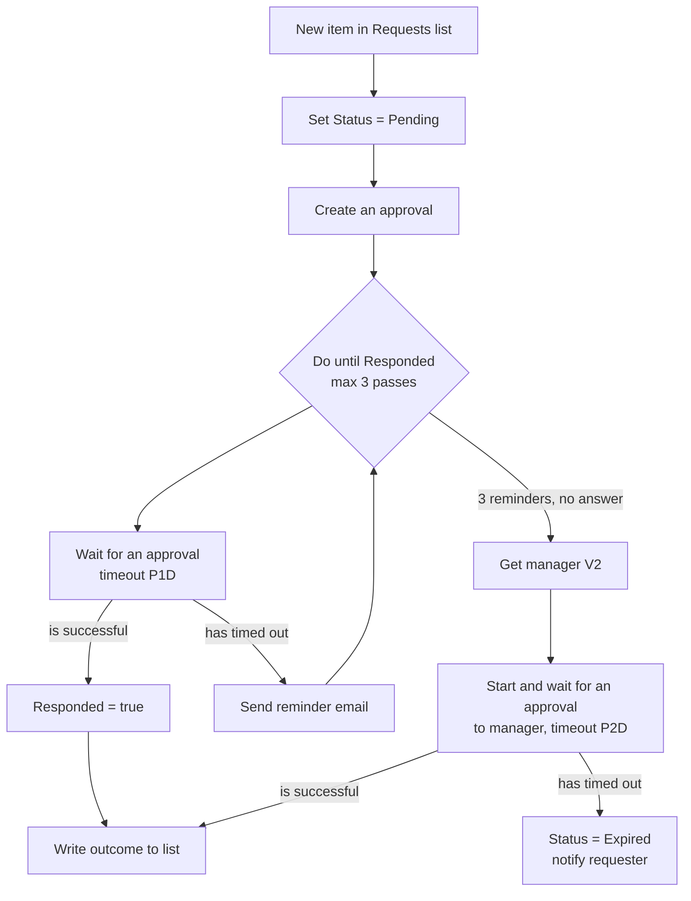

# Power Automate approval flow with reminders and escalation

A reference build for the approval flow most teams actually need. The request is tracked in a SharePoint list, the approver gets a reminder each day they don't respond, and the request moves to their manager after the last reminder. Every outcome, including "nobody answered", is written back to the list so the requester can see where things stand.

The parts are standard (SharePoint, Approvals, Office 365 Users, Outlook). No premium connectors, no code.

> Written guide with the reasoning behind each choice: **[How to Build a Power Automate Approval Flow (with Reminders and Escalation)](https://asemalabtah.com/blog/automate-approval-workflows-power-automate)**

---

## Why approval flows stall

Approval flows fail in two places:

1. **Nobody can see where a request is.** It lives inside a running flow, so the only way to find out is to ask someone.
2. **Nothing happens when an approver goes quiet.** By default *Start and wait for an approval* waits until the run expires at 30 days, then fails without telling anyone.

The status column below fixes the first. The reminder loop and escalation fix the second.

## Flow at a glance

## 1. The Requests list

Create a SharePoint list called **Requests**:

| Column | Type | Notes |
|---|---|---|
| Title | Single line of text | What is being requested |
| Requester | Person | Who asked |
| Approver | Person | First approver |
| Details | Multiple lines of text | Enough for the approver to decide without opening anything else |
| Status | Choice | `Pending`, `Approved`, `Rejected`, `Escalated`, `Expired` |
| DecisionBy | Person | Who actually decided |
| DecisionDate | Date and time | |
| Comments | Multiple lines of text | Approver's comments |

**Status** is the column everyone looks at. Make it the first column in the default view.

## 2. Trigger and first update

1. **Trigger:** *When an item is created* (SharePoint), on the Requests list.
2. **Update item:** set `Status` to `Pending`.
3. **Initialize variable** `Responded` (Boolean) = `false`.
4. **Initialize variable** `Reminders` (Integer) = `0`.

## 3. Create the approval (don't wait yet)

Use **Create an approval**, not *Start and wait for an approval*.

*Start and wait* bundles sending and waiting into one action. When it stops waiting, the request is effectively dead: a late response has nowhere to go. Splitting it keeps the original request live, so a reminder can point the approver back to it.

- Approval type: `Approve/Reject - First to respond`
- Title: `Approval needed: @{triggerOutputs()?['body/Title']}`
- Assigned to: `@{triggerOutputs()?['body/Approver/Email']}`
- Details: the request details, plus a link to the list item.

## 4. The reminder loop

Add **Do until** with the condition `Responded` is equal to `true`.

In the loop's settings, set **Count** to `3` and **Timeout** to `P5D`. Without these, a request nobody ever answers keeps the run alive until the platform stops it.

Inside the loop:

1. **Wait for an approval**
   - Approval ID: `@{body('Create_an_approval')?['name']}`
   - **Settings → Timeout:** `P1D` (one day, ISO 8601).
2. **Set variable** `Responded` = `true`
   - **Configure run after:** *is successful* only.
3. In a **parallel branch** from *Wait for an approval*:
   - **Increment variable** `Reminders` by 1
   - **Send an email (V2)** to the approver: "You have an approval waiting: *Title*. Open it from the Approvals app in Teams or Power Automate."
   - **Configure run after** on both: *has timed out* only.

So each day the approver hasn't answered, the wait times out, a reminder goes out, and the loop goes round again. The moment they respond, the next wait succeeds and the loop ends.

## 5. Escalation

After the loop, add a **Condition**: `Responded` is equal to `false`.

**If yes** (three reminders, still no answer):

1. **Update item:** `Status` = `Escalated`.
2. **Get manager (V2)** (Office 365 Users) for the original approver.
3. **Start and wait for an approval** to the manager.
   - Same title and details, with "Escalated after 3 reminders" in the body.
   - **Settings → Timeout:** `P2D`.
4. **Update item** with the manager's outcome. Configure run after: *is successful*.
5. **Update item** with `Status` = `Expired`, then email the requester. Configure run after: *has timed out*.

**If no** (the first approver answered): write the outcome, as in the next step.

## 6. Write the outcome back

Read the result from whichever approval completed:

| Field | Expression |
|---|---|
| Outcome | `body('Wait_for_an_approval')?['outcome']` |
| Decided by | `body('Wait_for_an_approval')?['responses']?[0]?['responder']?['email']` |
| Comments | `body('Wait_for_an_approval')?['responses']?[0]?['comments']` |
| Decision date | `utcNow()` |

**Update item:** `Status` = the outcome (`Approve` → `Approved`, `Reject` → `Rejected`), plus `DecisionBy`, `DecisionDate` and `Comments`. Then email the requester the result.

## Common errors

**"The flow fails after the approval times out."**
Expected. A timed-out approval has no `outcome`, so any step that reads it fails on a null value. Handle the timeout with its own *has timed out* path, as above, instead of a condition on the outcome. If something downstream still needs a value, use `coalesce(body('Wait_for_an_approval')?['outcome'], 'Expired')`.

**"The run failed after 30 days."**
A flow run can't last longer than 30 days ([Power Automate limits](https://learn.microsoft.com/en-us/power-automate/limits-and-config)). All the waits added together (reminders plus escalation) have to stay well under that. The defaults here add up to five days.

**"The approver answered the original request after it was escalated."**
The Approvals connector has no action to cancel a request, so the original stays in the approver's list. The flow has already moved on and ignores it. Say so in the escalation email so nobody is surprised.

## Testing without waiting days

While building, set the timeouts to minutes, then put the real values back before go-live:

- `P1D` → `PT2M`
- `P2D` → `PT3M`

You'll see a reminder arrive two minutes after you create a test item.

## Licensing

Everything here uses standard connectors and runs on the Power Automate rights included with most Microsoft 365 business plans. Moving the list to Dataverse makes the flow premium.

---

Built by **[Asem Alabtah](https://asemalabtah.com/about)**, a Microsoft-certified Power Platform developer (PL-200, PL-400). I build approval, inspection and HSE apps on Power Apps and Power Automate for teams on Microsoft 365.

If you need this built and fitted to your own process, see **[approval workflow automation](https://asemalabtah.com/services/approval-workflow-automation)**.

## License

MIT. See [LICENSE](LICENSE).
